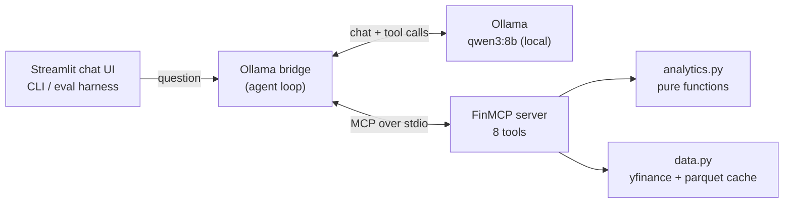

# FinMCP-MCP-Powered-Autonomous-Financial-Data-Analyst-Agent

A finance data-analysis agent that runs **fully locally**. A Qwen3 model served by Ollama plans and executes analyses by calling tools exposed over the **Model Context Protocol (MCP)**. Every number in an answer comes from a real tool call over real market data, so the model never has to guess a figure.

No paid API is needed. LLM inference runs on your machine; only market-data requests (Yahoo Finance via `yfinance`) leave it.

<!-- Add screenshots here after running the app, e.g.:

-->

## Headline results

Measured on a 10-question finance benchmark with `qwen3:8b`, thinking mode off, on a Windows HP laptop (September 2026).

| Metric | Result |
|---|---|
| Accuracy | **90% (9/10)** against live-computed ground truth |
| Average latency | 338.9 s per query (min 205.8 s, max 434.4 s) |
| Tool calls per query | 1.0 average |
| Tool errors / iteration-cap hits | 0 / 0 |

**Thinking-mode experiment (same question, same correct answer in every run):**

| Configuration | Latency for q1 | Answer |
|---|---|---|
| Thinking off (inside the full 10-question run) | 220.3 s | 21.11% (correct) |
| Thinking off (isolated single-question run) | 304.9 s | 21.11% (correct) |
| Thinking on | 986.7 s | 21.11% (correct) |

Disabling thinking mode for this tool-calling task cut latency by roughly **69-78% (3.2-4.5x faster)** with no change in the answer. This is a single question (n=1), and latency varies between runs, hence the range. The full 10-question set was run with thinking off only.

Raw reports are in [`eval/results/`](eval/results/).

## Architecture



1. The bridge launches the MCP server as a subprocess and discovers its tools over stdio.
2. MCP tool schemas are converted to Ollama's function-calling format.
3. The model picks a tool, the bridge executes it through the live MCP session and feeds the result back, and this repeats until the model gives a final answer (capped at 6 iterations).

### Tools exposed by the MCP server

| Tool | What it does |
|---|---|
| `get_stock_summary` | Price range, cumulative and average daily return, best and worst day |
| `get_company_info` | Sector, industry, market cap, P/E, 52-week range |
| `get_moving_averages` | Simple moving averages for chosen windows |
| `get_volatility` | Rolling and full-period annualized volatility |
| `get_anomalies` | Z-score based detection of unusual daily price moves |
| `compare_tickers` | Return and volatility comparison across tickers |
| `get_correlation` | Correlation matrix of daily returns |
| `plot_price_chart` | Price chart with optional 20/50-day SMA overlay, saved as PNG |

## Design decisions

- **MCP instead of wiring tools into one agent.** The tool layer is a standalone MCP server. It does not know whether the client is Ollama, Claude or anything else, so it can be tested and reused on its own. Ollama has no native MCP client, so `client/ollama_bridge.py` implements the translation and the agent loop.
- **Tool-grounded answers.** The system prompt forbids estimating figures; numeric claims must come from a tool result. This removes numeric hallucination as a failure mode and leaves tool selection as the thing to measure.
- **Pure analytics layer.** `server/analytics.py` has no I/O. It is unit-tested on synthetic data and reused by the eval harness as the ground-truth oracle.
- **Thinking mode off by default.** Qwen3 emits long reasoning traces by default, which multiplies latency on laptop hardware. It is off here (`--think` turns it on), and the experiment above shows the effect on this task.
- **Cross-platform subprocess launch.** The server is started with `sys.executable`, not a hardcoded `python3`, so it works on Windows and uses the same virtual environment as the parent process.
- **Debuggable failures.** Per-question timeouts, a live heartbeat while waiting on the model (`--verbose`), unwrapping of asyncio `ExceptionGroup` errors into readable messages, and partial-progress capture when a run times out (iteration reached, tool calls completed, per-call latency).

## Evaluation

`eval/benchmark.json` holds 10 questions. For each one, the harness computes the correct answer live by calling the same analytics functions the tools use, runs the agent, extracts the answer from its reply and compares it within a tolerance. Because ground truth is computed at run time, nothing is hardcoded or stale.

| # | Question | Ground truth | Agent | Tool used | Latency | Result |
|---|---|---|---|---|---|---|
| 1 | AAPL 6-month cumulative return | 21.11% | 21.11% | `get_stock_summary` | 220.3 s | Pass |
| 2 | MSFT 20-day SMA | 494.22 | 494.22 | `get_moving_averages` | 342.2 s | Pass |
| 3 | TSLA annualized volatility | 50.91% | 51.07% | `get_volatility` | 357.8 s | Pass (within 3%) |
| 4 | GOOGL vs AMZN, better performer | AMZN | AMZN | `compare_tickers` | 394.4 s | Pass |
| 5 | NVDA worst trading day return | -6.2% | +8.74% (wrong day) | `get_anomalies` | 434.4 s | **Fail** |
| 6 | AMD anomalous days (z >= 2.5) | 3 | 3 | `get_anomalies` | 391.3 s | Pass (exact) |
| 7 | JPM 50-day SMA | 350.68 | 350.68 | `get_moving_averages` | 423.8 s | Pass |
| 8 | META-AMZN return correlation | 0.452 | 0.452 | `get_correlation` | 312.4 s | Pass |
| 9 | AAPL average daily return | 0.1671% | 0.1671% | `get_stock_summary` | 306.5 s | Pass |
| 10 | MSFT sector | Technology | Technology | `get_company_info` | 205.8 s | Pass |

**The one failure (q5)** is a tool-selection error. The agent used `get_anomalies`, which ranks days by the size of the move in either direction, instead of `get_stock_summary`, which reports the worst day directly. It then reported an upside spike as the "worst" day. Clearer tool descriptions or an explicit extreme-day tool would be the natural fix.

Ground-truth values depend on the date the benchmark is run, so your numbers will differ from the table.

## Setup

Tested on Python 3.12 and 3.13 (Windows, Python 3.13).

### 1. Install Ollama and pull the model

Download Ollama from [ollama.com/download](https://ollama.com/download), then:

```bash
ollama pull qwen3:8b
ollama run qwen3:8b "say hello"   # confirm it responds
```

If your machine has 8 GB of RAM or less, use `qwen3:4b` instead (faster, less reliable on tool selection) and pass `--model qwen3:4b` below.

### 2. Clone the repo and install dependencies

```bash
git clone https://github.com/<your-username>/finmcp.git
cd finmcp
```

Windows (PowerShell):

```powershell
python -m venv venv
venv\Scripts\activate
pip install -r requirements.txt
```

If PowerShell blocks activation, run `Set-ExecutionPolicy -ExecutionPolicy RemoteSigned -Scope CurrentUser` once.

macOS / Linux:

```bash
python3 -m venv venv
source venv/bin/activate
pip install -r requirements.txt
```

### 3. Run the unit tests (no Ollama or internet needed)

```bash
python -m pytest tests/ -v
```

### 4. Ask the agent a question from the command line

```bash
python -m client.ollama_bridge "What's AAPL's 20-day moving average?"
python -m client.ollama_bridge --verbose "How volatile has TSLA been?"
```

### 5. Launch the chat UI

```bash
streamlit run app/streamlit_app.py
```

### 6. Run the benchmark

```bash
python -m eval.run_eval --model qwen3:8b --limit 3 --timeout 900   # quick check
python -m eval.run_eval --model qwen3:8b --timeout 900             # full 10 questions
```

| Flag | Purpose |
|---|---|
| `--model` | Ollama model tag (default `qwen3:8b`) |
| `--limit N` | Run only the first N questions |
| `--timeout S` | Per-question time limit in seconds (default 240, raise it on slower hardware) |
| `--think` | Enable Qwen3 thinking mode |
| `--verbose` | Live progress and a heartbeat every 10 s while waiting on the model |
| `--output FILE` | Report filename inside `eval/` (use distinct names when comparing runs) |
| `--ollama-host URL` | Use an Ollama server on another host |

On a laptop, expect roughly 3-7 minutes per question. The default 240 s timeout is too short for that, so use `--timeout 900` or higher.

## Project structure

```
finmcp/
├── server/
│   ├── finance_server.py   # MCP server exposing the 8 tools
│   ├── analytics.py        # pure computation functions (unit-tested)
│   └── data.py             # yfinance wrapper with 4-hour parquet cache
├── client/
│   └── ollama_bridge.py    # MCP <-> Ollama translation and agent loop
├── app/
│   └── streamlit_app.py    # chat UI with tool-call trace
├── eval/
│   ├── benchmark.json      # 10 questions with ground-truth specs
│   ├── run_eval.py         # evaluation harness
│   └── results/            # saved benchmark reports
├── tests/
│   └── test_analytics.py   # 11 unit tests
├── requirements.txt
└── README.md
```

## Limitations

- **Small benchmark.** 10 questions, one run per configuration. Latency varies between runs (the same question took 220 s and 305 s), so treat latency figures as indicative.
- **Single-tool questions.** Every benchmark question was answered with exactly one tool call, so the benchmark does not yet exercise multi-step planning, even though the agent loop supports up to 6 iterations.
- **Ground truth shares code with the tools.** The oracle reuses the analytics functions, so the benchmark checks tool selection and answer reporting. It cannot catch a bug in the analytics themselves (the unit tests cover that) or bad upstream data.
- **Heuristic answer extraction.** Scoring takes the closest number in the agent's reply, which can pick up fragments such as a date. In q5 it picked a piece of a date. The verdict was still correct there, but the scorer is not airtight.
- **Not interactive.** Several minutes per query on laptop hardware. A GPU or a smaller model would change this.
- **Data source.** `yfinance` is an unofficial scraper and can rate-limit or return stale data. Results are cached for 4 hours and no explicit network timeout is set.
